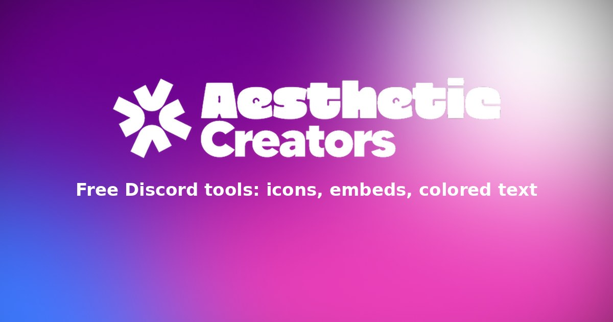

<div align="center">



# Aesthetic Creators

**Free Discord tools that run in your browser: download role icons, emojis and stickers, build messages, color and format text, generate timestamps and bot invite links.**

[](https://zhaak63.github.io/Role-Icon-Downloader/)
[](https://discord.gg/94seN7srjv)


</div>

---

## Tools

| Tool | What it does |
| --- | --- |
| [**Downloader**](https://zhaak63.github.io/Role-Icon-Downloader/downloader/) | Download a server's **role icons, emojis, stickers** and its **icon, banner and invite splash** as a ZIP. Search, pick sizes (64 to 1024 px), choose file names, download one image or everything. |
| [**Message builder**](https://zhaak63.github.io/Role-Icon-Downloader/message-builder/) | Build messages with **Components V2** (containers, sections, galleries, buttons, select menus) or **classic embeds**, with a live preview. Export **JSON** or **discord.js** code, or send through a **webhook**. Import JSON, save templates, share a link. |
| [**Colored text**](https://zhaak63.github.io/Role-Icon-Downloader/colored-text/) | Multi-color **ANSI code blocks** for Discord. Select a word and color just that word. |
| [**Text formatter**](https://zhaak63.github.io/Role-Icon-Downloader/text-formatter/) | Discord formatting (bold, italic, underline, strikethrough, spoiler, code, quote, headings, lists) with a preview, plus **21 Unicode fonts** for nicknames and messages. |
| [**Timestamps**](https://zhaak63.github.io/Role-Icon-Downloader/timestamps/) | Pick a date and a time zone and copy the `<t:…>` code in all 7 formats. Everyone sees it in their own language and time zone. |
| [**Bot invite**](https://zhaak63.github.io/Role-Icon-Downloader/bot-invite/) | Generate a bot **invite link**: tick the permissions (or paste a permissions number), choose the scopes and a preselected server. |
| [**Icon maker**](https://zhaak63.github.io/Role-Icon-Downloader/icon-maker/) | Draw a **role icon**: shapes, gradients, borders, transparent background, a symbol from a solid icon library or your own image. Export a PNG. |
| [**About / FAQ**](https://zhaak63.github.io/Role-Icon-Downloader/about/) | How it works, what happens to your token, and the limits of each tool. |

## Features

- **5 languages** with flags: French, English, Spanish, Portuguese (Brazil) and German. The language follows your browser and is remembered.
- **Light and dark themes**, and a responsive layout with a slide-in menu.
- **Search** on the home page (press `/` to focus it).
- **One page per tool**, each with its own address, title and link preview.
- No account, no server of ours, no tracking.

## Security and privacy

- Everything runs **in your browser**. Your token is **never stored**, is only sent to `discord.com`, and disappears when you close the tab. Webhook URLs and messages are never sent to us either.
- Only what you save yourself stays in your browser: message templates, your theme and your language choice.
- The page also loads public resources (JSZip from cdnjs, Phosphor icons from jsDelivr, images from Discord's CDN), never with your token.
- There is **no build step and no backend**: the whole app is plain HTML and JavaScript that you can read in your browser.
- A user token gives access to your **entire account**. Never share it, and never paste code in your console that you don't understand.
- Using a user token outside the Discord app goes against Discord's Terms of Service. Use it at your own risk, or use a bot token or the **manual JSON** mode, which needs no token at all.

## Good to know

- Role icons only exist on servers with **boost level 2 or higher**. Roles that use a standard emoji instead of an image can't be downloaded.
- **Lottie** stickers can't be converted to an image and are skipped.
- ANSI colors are unreliable on Discord mobile.
- Select menus are interactive components: Discord only accepts them from a bot, so they are not sent through webhooks. Components V2 need discord.js 14.19 or newer.
- The relative timestamp preview (`R`) is approximate.
- Unicode fonts are not read by screen readers.
- Permission names in the bot invite tool are Discord's own, in English.

## Host your own copy

1. Fork this repository (or upload the files to a new one).
2. Go to **Settings > Pages**, choose **Deploy from a branch**, the `main` branch and the `/ (root)` folder, then **Save**.

The site works from any folder or from a custom domain: the base path is detected automatically. Each tool lives in its own folder with an `index.html`:

```
index.html              home
downloader/             downloader
message-builder/        message builder
colored-text/           colored text
text-formatter/         text formatter
timestamps/             timestamps
bot-invite/             bot invite
icon-maker/             icon maker
about/                  about / FAQ
sitemap.xml             sitemap for search engines
og-image-2.jpg          link preview image
```

Every page is the same self-contained app; only the title, description and link preview differ.

## Community and support

Need help, found a bug or want a new tool? Join the support server.

[](https://discord.gg/94seN7srjv)

## Credits

Made by **Aesthetic Creators**. Inspired by [Discord Emoji Downloader](https://github.com/ThaTiemsz/Discord-Emoji-Downloader) by ThaTiemsz.

Solid icons in the icon maker: [Phosphor Icons](https://phosphoricons.com) (MIT). ZIP files: [JSZip](https://stuk.github.io/jszip/). Permission values: [Discord's developer documentation](https://docs.discord.com/developers/topics/permissions).

*This project is not affiliated with Discord Inc.*

---

<details>
<summary><b>🇫🇷 Version française</b></summary>

### Présentation

**Aesthetic Creators** est une boîte à outils gratuite pour Discord, qui tourne dans ton navigateur : télécharger les **icônes de rôles, emojis et stickers** d'un serveur, créer des **messages** (composants V2 et embeds), **colorer** et **mettre en forme** du texte, générer des **timestamps** et des **liens d'invitation de bot**, et dessiner des **icônes de rôles**.

### Les outils

- **Téléchargeur** : icônes de rôles, emojis, stickers et images du serveur en ZIP, avec recherche, choix de la taille et des noms de fichiers.
- **Créateur de messages** : composants V2 ou embeds classiques avec aperçu en direct, export JSON ou discord.js, envoi par webhook, import, modèles et lien de partage.
- **Texte coloré** : blocs ANSI multicolores, avec une couleur différente par mot.
- **Formateur de texte** : mise en forme Discord et 21 polices Unicode.
- **Timestamps** : le code `<t:…>` dans les 7 formats, avec choix du fuseau horaire.
- **Invitation de bot** : lien d'invitation avec choix des permissions.
- **Créateur d'icônes** : icônes de rôles avec bibliothèque d'icônes pleines, fond transparent et export PNG.
- **À propos / FAQ** : fonctionnement, sécurité du token et limites.

### Sécurité

- Tout se passe **dans ton navigateur** : ton token n'est **jamais enregistré**, il n'est envoyé qu'à `discord.com` et disparaît quand tu fermes l'onglet. Rien ne passe par un serveur à nous.
- Seuls tes modèles, ton thème et ta langue sont gardés dans ton navigateur, uniquement si tu les enregistres ou les choisis.
- Un token de compte donne accès à **tout ton compte** : ne le partage jamais. L'utiliser en dehors de l'application Discord va à l'encontre de ses conditions d'utilisation. Le mode **JSON manuel** n'utilise aucun token.

### Limites

- Les icônes de rôles demandent un serveur au **niveau 2 de boost** ou plus.
- Les stickers **Lottie** sont ignorés.
- Les couleurs ANSI sont peu fiables sur mobile.
- Les menus déroulants ne sont pas envoyés par webhook (il faut un bot).

### Héberger sa propre copie

Fais un fork, puis **Settings > Pages**, branche `main`, dossier `/ (root)`. Le site fonctionne dans n'importe quel dossier ou avec un nom de domaine à toi.

### Support

Une question, un bug ou une idée d'outil ? Rejoins le [serveur Discord de support](https://discord.gg/94seN7srjv).

</details>
